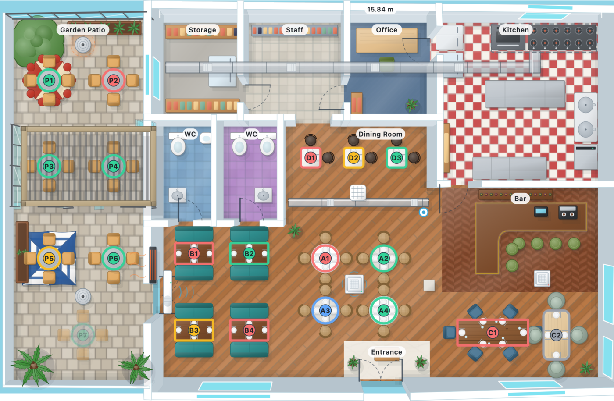
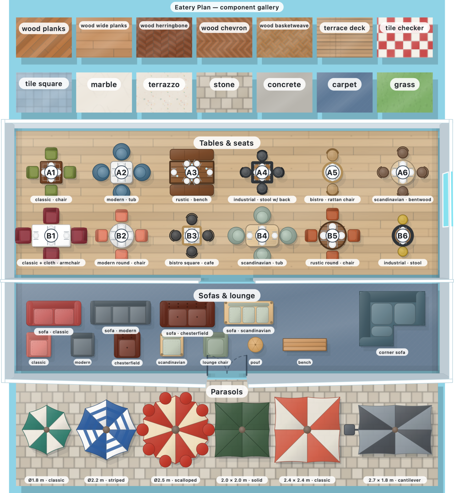
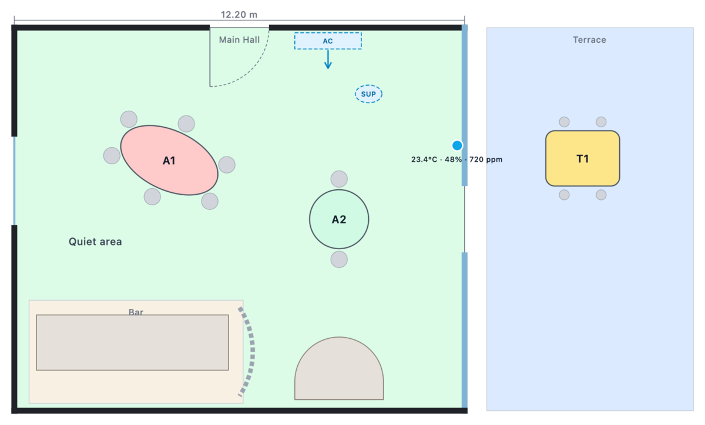
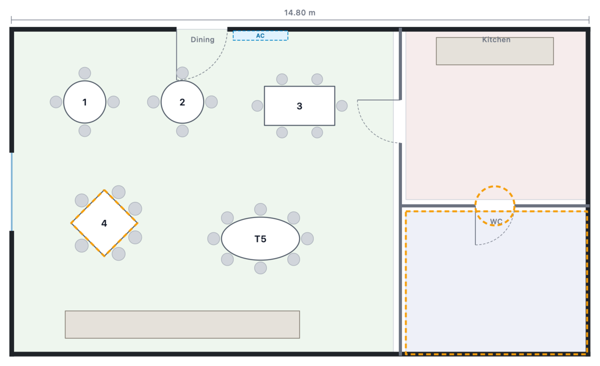

# Eatery Plan

**An open JSON format for restaurant, cafe and bar floor plans** — tables, zones, walls, doors, furniture,
HVAC equipment and sensors — designed to be drawn identically on the web, iOS, Android and desktop, and to be
produced from a photo or sketch of a floor plan.

[Türkçe](README.tr.md)



*[`examples/restaurant.json`](examples/restaurant.json) with live table status, drawn entirely in code by the
illustrated theme, walls with 3D depth. The JSON only says what things are (zone kinds, floor finish, materials, colours, chair style);
the renderer decides how they look.*

**Component gallery** — every floor, table style, seat, sofa and parasol variant ([`examples/showcase.json`](examples/showcase.json)):



| Plain theme with live status | Plan imported from a drawing |
|---|---|
|  |  |

Dashed amber outlines mark objects that need a person to confirm them.

## Why

- **One plan, every screen.** Geometry is stored in floor units with a fixed origin and axis convention; clients
  scale it to fit. The aspect ratio of the real room is kept.
- **Physical layout only.** Orders, reservations, live table status and sensor readings stay in your existing
  systems and are joined by id ([table state](schemas/v1.5.0/table-state.schema.json),
  [telemetry](schemas/v1.5.0/environment-telemetry.schema.json)).
- **Made to be generated.** A pixel-based [detection format](schemas/v1.5.0/detection.schema.json) and a
  deterministic importer turn any drawing into a validated plan, with confidence and review flags.
- **Strictly validated.** JSON Schema for structure, plus a reference validator for references and geometry.
- **Looks are data, drawing is code.** Optional `appearance` fields (floor finish, material, colours, chair style)
  let themes render the same plan as a plain plan or a colourful illustration.
- **Every object is a component.** Tables, zones, pergolas, glass walls and devices can be made active or passive,
  opened or closed and switched on or off through a live object-state document — the plan never changes.
- **Extensible.** Every object has a namespaced `extensions` map.

## What is in the repository

```
schemas/v1.5.0/     eateryplan · table-state · object-state · environment-telemetry · detection (JSON Schema 2020-12)
examples/           sample plan, live table state, telemetry, a detection and the plan imported from it
docs/               specification · rendering contract · image import
python/eateryplan/  validator, legacy migrator, detection importer (CLI + library)
js/                 dependency-free renderer (plain + illustrated themes) → SVG / react-native-svg / Canvas
demo/               browser viewer
```

## Quick start

### Validate

```bash
pip install -e python
eateryplan validate examples/plan.json
eateryplan validate examples/plan.json --json      # machine-readable issues
eateryplan check-state examples/plan.json examples/table-state.json
eateryplan check-telemetry examples/plan.json examples/telemetry.json
eateryplan check-objects examples/restaurant.json examples/restaurant-objects.json
```

### Import a drawing

```bash
eateryplan import examples/detection.json my-plan.json --image drawing.png --name "My cafe"
```

How to obtain `detection.json` from an image is described in [docs/image-import.md](docs/image-import.md).

### Render

```js
import { buildScene, toSvg } from "./js/src/eateryplan-render.mjs";

import { buildIllustratedScene } from "./js/src/eateryplan-illustrated.mjs";

const scene = buildScene(plan, { tableStates, readings: { sensor_1: telemetry } });   // plain theme
const art = buildIllustratedScene(plan, { tableStates });                               // illustrated theme
element.innerHTML = toSvg(art);            // web
// React Native: examples/react-native/EateryPlanView.tsx (react-native-svg)
// Canvas:       scene.items.forEach(i => i.type === "path" && ctx.fill(new Path2D(i.d)))
```

From the command line:

```bash
node js/bin/render.mjs examples/restaurant.json plan.html --style illustrated --state examples/restaurant-state.json
```

Open the viewer locally:

```bash
python3 -m http.server 8000
```

Then browse to `http://localhost:8000/demo/`.

## A table, in short

```json
{
  "id": "table_1",
  "floorId": "floor_0",
  "zoneId": "zone_salon",
  "number": "A1",
  "kind": "standard",
  "shape": { "kind": "ellipse", "cx": 250, "cy": 220, "rx": 70, "ry": 40, "rotationDeg": 25 },
  "seats": 6,
  "externalTableId": "pos-312"
}
```

Shapes are `rect`, `ellipse`, `polygon` and `path` (SVG commands including arcs). Walls may be curved with a
`bulge`. Doors and windows are attached to walls by position.

## Tests

```bash
cd python && python -m unittest discover -s tests
cd js && npm test
```

## Status

Format version **1.5.0** (all 1.x documents stay valid). The format follows semantic versioning; see [CHANGELOG.md](CHANGELOG.md) and the versioning
rules in the [specification](docs/specification.md#8-extensibility-and-versioning). Issues and pull requests are
welcome.

## License

[MIT](LICENSE)
